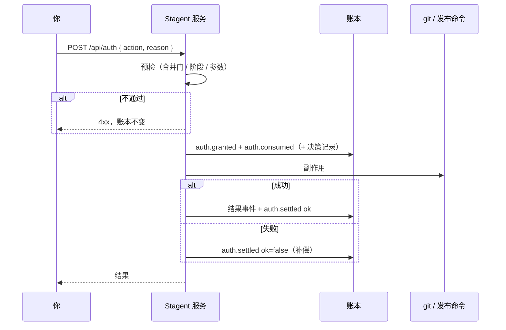

# 授权三段式事务与服务端合并门（M2-3）

对应规格 §6（守卫·合并前校验、需授权的动作）、D21/D22 与 tasks.md 的 M2-3。代码：`src/server/auth.ts`（`Authorizer`）、`src/server/service.ts`、`src/server/http.ts`。

## 需授权的动作

| 动作 | 接口 | 何时可用 | 副作用 | 结果事件 |
|---|---|---|---|---|
| `merge` 合并 | `POST /api/changes/:id/merge`（**免填原因**） | 改动「可合并」 | 合并门 → `git add -A` + `git commit` | `change.merged { mergeCommit, files, authId }` |
| `merge_override` 授权强行合并 | `POST /api/auth` | 改动被阻止 / 实现中 / 待确认外观（不在确认例子、不在检查中） | 同上（一次授权即合并） | `change.merged` |
| `abandon` 放弃改动 | 先 `GET /api/changes/:id/abandon-preview` 看受影响文件，再 `POST /api/auth` | 任何未在检查中的进行中改动 | 工作区还原到基准提交（`.stagent/` 不动） | 本改动锁定的例子 `example.unlocked`、本改动新建的功能 `feature.retired`、`change.abandoned { files }` |
| `modify_locked` 修改锁定例子 | `POST /api/auth { exampleId }`，改好后 `POST /api/examples/:id/relock` | 任意锁定例子 | 解锁 | `example.unlocked { authId }`；重锁时写新快照与 `example.locked`，并自动跑全量回归 |
| `delete` 退役功能 | `POST /api/auth { featureId }` | 任意功能 | — | 例子 `example.unlocked`、`feature.retired` |
| `release` 发布上线 | `POST /api/auth` | 配置了 `releaseCommand` | 运行发布命令（日志在 `.stagent/runs/release-<authId>.log`） | `release.executed { exitCode }`；退出码非 0 时 `auth.settled.ok=false` |
| `budget_raise` 提高费用上限 | `POST /api/auth { amount? }` | 由 M3-1 触发 | — | 只记录授权 |

除 `merge` 外，原因必填且至少 4 个字。每个带原因的授权同时写一条决策记录 `record.saved { kind: 'decision', tags: ['授权'], body: 原因 }`（#9），交付报告（M5-2）从账本读取。

## 三段式

所有授权动作在同一把互斥锁里**串行**执行：

1. **预检**：合并门、阶段、参数。不通过直接返回 4xx，账本里什么都不写。
2. **授权与消费**：一次事务写入 `auth.granted` + `auth.consumed`（+ 决策记录），**先于副作用**落盘。每次请求一个新 `authId`，立即消费，所以授权是一次性的。
3. **副作用**。
4. **结算**：一次事务写入结果事件 + `auth.settled { ok }`。副作用抛错时只写 `auth.settled { ok: false, detail }`（补偿），不写结果事件；合并失败时撤销暂存（`git reset`）。

**并发**：两笔合并同时到达，只有一笔能通过预检并消费授权，另一笔看到改动已合并返回 409。账本里恰好一条 `auth.consumed`（#17）。

**悬挂消费**：第 2 步之后、第 4 步之前进程崩溃，账本里会留下已消费、未结算的授权。重启后结论卡和页首会列出来，**不自动重试**：发布命令绝不会因为重启而执行第二次（#19）。你确认实际情况后点「我已确认处理」（`POST /api/auth/:authId/dismiss`），系统补一条 `auth.settled { ok: false }`。

## 合并门（唯一的强制边界）

合并和强行合并都必须通过：

1. 重新读盘校验整条事件链；锁定（🔒）则拒绝；
2. 对每个锁定例子：快照文件存在且内容 sha256 等于 `checkHash`，**并且**工作区里的检查文件也等于 `checkHash`。

任何一项不符就拒绝合并，原因写明哪些检查被改。Cursor 或手写改了锁定检查时（无法在写入时拦截），结论卡显示「锁定检查被修改」，合并按钮禁用，只给两个选项（#3）：

- 「还原锁定文件」（`POST /api/examples/:id/restore`，从快照恢复，不需要授权）；
- 「授权修改锁定例子」（`modify_locked`）。

强行合并也不能绕过这一步。

通过后 `git add -A` + `git commit --allow-empty`。提交信息带 `Stagent-Change: <changeId>`，环境变量 `STAGENT_MERGE=1` 让 pre-merge-commit 提醒静默。仓库没配提交身份时用 `Stagent <stagent@localhost>`。`change.merged.files` 是基准到合并提交的文件清单（含重命名，不含 `.stagent/ledger/` 下 Stagent 自己的记录），供 M4-3 使用。

**在 Stagent 之外的提交**（包括 `git commit --no-verify` 绕过 hook）只会被记为未托管提交并补跑回归，改动**不会**因此变成已合并（Invariant 5）。授权事务进行中时不做未托管提交检查，因为那时 HEAD 的前进是 Stagent 自己造成的。

## 放弃改动

- 预览列出会被还原的文件：未提交的修改、新文件（会删除）；如果改动期间有未托管提交，也列出那些提交改过的文件。
- 执行 `git restore --source=<基准> --staged --worktree -- . ':(exclude).stagent'` 和 `git clean -fd -- . ':(exclude).stagent'`（不加 `-x`，被忽略的文件不动）。账本、快照、检查文件都在 `.stagent/` 下，不受影响。
- 还原后告诉文件监听"这是自己改的"，不会被识别成新的外部改动。

## 不变量

- **Invariant 5**：所有合并经过合并门（`test/server/auth.test.ts`）。
- **Invariant 6**：每个带 `authId` 的副作用事件之前有同一 `authId` 的 `auth.consumed`、之后有 `auth.settled`；每个授权只消费一次，消费前有 `auth.granted`（`test/invariants/`）。

## 推断与待规格确认

spec v2.2 未随任务提供，以下为推断：

- 授权与消费在同一个请求里完成（没有"先授权、稍后再用"的流程）；
- 放弃改动时，解锁本改动锁定的例子、退役本改动新建的功能；
- 改动期间有未托管提交时，放弃会把工作区还原到基准，但不移动 HEAD（改动以未提交的回退形式留在工作区）；
- 所有带原因的授权都写决策记录，不只是强行合并。

## 不在 M2-3

`budget_raise` 的触发（M3-1）；记录删除（M5-1）；外部锚点与恢复协议（M6-1）。
