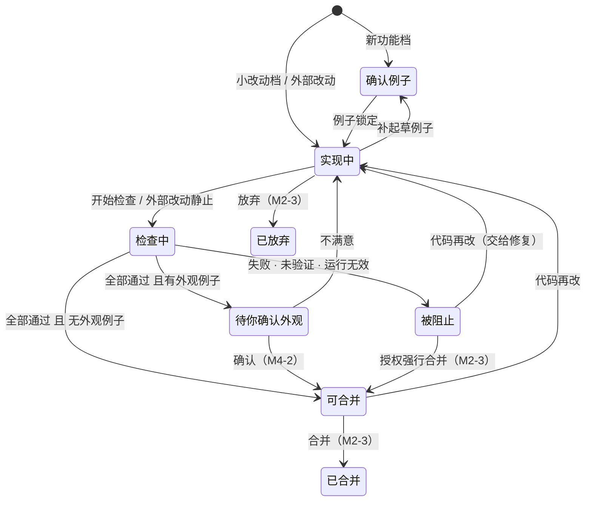

# 改动流程：两档、互斥、外部改动识别与状态机（M2-2）

对应规格 §5.0–§5.4、§11（详情抽屉）与 tasks.md 的 M2-2。代码：`src/changes/changes.ts`（纯投影）、`src/server/service.ts`（编排）、`src/server/watcher.ts`（文件监听）。

M2-2 还没有接 AI：Claude Code 驱动在 M3，授权与合并在 M2-3。现在可以手动或用 Cursor 改代码，由 Stagent 识别改动、跑检查、给出结论。

## 改动与互斥（§5.0）

- 同一时间只有一个进行中的改动（有 `change.started`，还没有 `change.merged` / `change.abandoned`）。
- `POST /api/changes`：已有进行中的改动时返回 **409**。并发请求在账本写锁内再查一次，只有一个能建成。
- 由 Stagent 发起的改动 `source: 'claude-code'`（M3 起由 Claude Code 执行）；自动识别的改动 `source: 'external'`。

## 两档（§5.1、§5.2）

| 档位 | 流程 |
|---|---|
| 小改动 `small` | 实现 → 全量回归 → 全部通过即可合并；不新增例子，不需要截图确认 |
| 新功能 `feature` | 起草例子 → 确认并锁定 → 实现 → 全量回归（含新例子）→ 外观确认（有外观例子时）→ 合并 |

- 升档 `POST /api/changes/:id/track { track: 'feature' }` → `change.track_upgraded`；降档 `{ track: 'small', reason? }` → `change.track_downgraded`。本改动已锁定例子后不能降档（409）。
- 起草例子 `POST /api/changes/:id/examples`：`featureId`（已有功能）或 `featureName`（新建功能）+ 情况 / 操作 / 期望 + `checkPath`（已写好、在 `.stagent/checks/` 下）。只有新功能档可以起草；实现中也可以补例子，改动会回到「确认例子」。M3-2 起改为由 Claude Code 起草。
- 确认并锁定 `POST /api/changes/:id/examples/lock { exampleIds? }`：写检查快照与 `example.locked`（带 `changeId`）。不传 `exampleIds` 时锁定本改动全部草稿。先失败检查的强制要求在 M3-2 加入。
- 开始检查 `POST /api/changes/:id/check`：对全部已锁定例子跑全量回归，`run.completed` 带 `changeId`。还在确认例子阶段时返回 409。

## 状态机（§5.4）

阶段只由服务端从事件推导（`projectChanges`），Claude Code 和前端都不能直接设置。按顺序取第一条成立的：

| 条件 | 阶段 | 进度条 |
|---|---|---|
| 有 `change.merged` / `change.abandoned` | 已合并 / 已放弃 | ④ / — |
| 本改动的检查正在运行 | 检查中 | ③ |
| 新功能档，还没有锁定例子，或还有未锁定的草稿 | 确认例子（草稿都跑过先失败检查 → 先失败检查） | ① |
| 本改动还没有运行过检查 | 实现中 | ② |
| 最近一次运行之后工作区又变了 | 实现中（这就是"交给修复"后的状态） | ② |
| 运行之后外观被确认为不满意 | 实现中 | ② |
| 有失败、未验证的锁定例子，或运行无效 | 被阻止 | ③ |
| 本改动锁定的外观例子还没在运行后确认 | 待你确认外观 | ④ |
| 其余 | 可合并 | ④ |

被阻止时，结论卡点名受影响的功能（例如「「登录」的例子失败：……」），并给出「交给 Claude Code 修复」（M3 前禁用）和「授权强行合并」（M2-3 前禁用），按钮旁都写明原因。

## 外部改动（§5.3）

- `stagent` 启动后用 chokidar 监听项目目录（忽略 `.git`、`node_modules`、`.stagent/runs`、`.stagent/ledger`、`dist`、`.next`、`coverage`），**最后一次变化后静止 2 秒**才处理。
- 处理时重算 workTreeHash，和上次看到的一样就忽略。所以被 `.gitignore` 忽略的文件、构建产物的变化都不算改动。
- 没有进行中的改动 → 自动建 `change.started { source: 'external', track: 'small', baseCommit: HEAD, firstObservedWorkTreeHash }`。
- 有进行中的改动 → 变化并入它，不新建（#14）。
- 外部来源的改动在静止后**自动进入检查**（跑全量回归）；运行中又有新变化时，执行器会把这轮标为 `valid=false` 并重跑，结束后再按需补跑一次。
- Cursor 或手写的改动无法在写入时拦截，只能靠合并前校验兜底（M2-3）。界面上有说明。

### 在 Stagent 之外直接 git commit

启动时，以及监听期间每 3 秒，比较当前 HEAD 和"Stagent 已知的最近一个 HEAD"。已知 HEAD 取最后出现的 `change.started.baseCommit`、`change.merged.mergeCommit`、`change.unmanaged_commit.toCommit`；都没有时退回最近一次运行的 `endCommit`。HEAD 是已知 HEAD 的后代（前进了）时：

- 记一条 `change.unmanaged_commit { fromCommit, toCommit }`，在改动面板上显示为"未经 Stagent 合并的提交"；
- 补跑全量回归（#15）。

切分支或回退不算"前进"，不记录。

## 界面

- 结论卡围绕进行中的改动回答"能不能继续、差什么、要我做什么"：确认例子 / 待你确认外观 → 👀，实现中 / 被阻止 → ⛔，可合并 → ✅。
- 改动面板：档位、来源、基准提交、①确认例子 → ②实现 → ③检查 → ④确认并合并 进度条（小改动档划掉 ①）、原因列表、升 / 降档、草稿列表、「确认并锁定」、起草表单、「开始检查」。
- 详情抽屉：本功能属于进行中的改动时，头部显示档位与进度条；被阻止时显示原因。
- 没有进行中的改动时显示「描述一个改动」（小改动 / 新功能）。
- M1-3 的临时演示入口（`/api/dev/*` 与虚线面板）已删除。

## 推断与待规格确认

spec v2.2 未随任务提供，以下为推断：

- 「交给修复」不需要单独的事件：最近一次运行之后工作区变了，就推导为实现中（M3-1 的 `POST /api/changes/:id/fix` 会在此基础上驱动 Claude Code）；
- 先失败检查阶段的推导条件（草稿都已有 red_check 运行但还没锁定），细节以 M3-2 为准；
- 外部改动静止后自动检查；Stagent 发起的改动在 M2-2 里手动点「开始检查」；
- 已知 HEAD 的取法，以及"切分支 / 回退不记录"。

## 不在 M2-2

授权与合并、放弃（M2-3）；AI 起草与实现、AI 判断档位（M3）；外观截图确认（M4-2）；「改了什么」（M4-2）。
